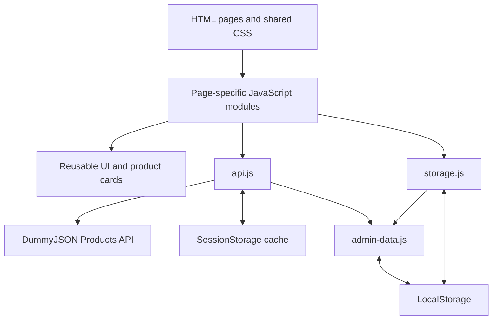

# TechNest

**A modern, responsive electronics store built with HTML, CSS and vanilla JavaScript.**


TechNest is an introductory web development group project that demonstrates a complete simulated e-commerce experience using standard web technologies. Users can discover electronics, browse and filter products, save favorites, manage a shopping cart, complete a simulated purchase and view order receipts. An administration interface supports product and inventory management.

The application uses the [DummyJSON Products API](https://dummyjson.com/docs/products) as its source of product data and browser storage to preserve local changes and shopping activity. No frontend framework, backend server or database is required.

> **Project scope:** TechNest is an educational prototype, not a production-ready online store. Customer accounts, administrator authentication and real payments are intentionally outside the scope of the assignment.

## Contents

- [Features](#features)
- [Pages](#pages)
- [Technology stack](#technology-stack)
- [Getting started](#getting-started)
- [Project structure](#project-structure)
- [How the application works](#how-the-application-works)
- [API and CRUD operations](#api-and-crud-operations)
- [Browser storage](#browser-storage)
- [Responsive design and accessibility](#responsive-design-and-accessibility)
- [Testing](#testing)
- [Documentation](#documentation)
- [Project scope and limitations](#project-scope-and-limitations)
- [Future improvements](#future-improvements)

## Features

| Feature | Description |
| --- | --- |
| Featured products | Browse up to ten unique, in-stock API products across the four electronics categories in a homepage carousel with automatic rotation every six seconds, manual navigation and Play/Pause. |
| Product catalogue | Browse smartphones, laptops, tablets and mobile accessories. |
| Search, filters and sorting | Combine text search with category and brand filters; sort by name or price in ascending or descending order for price. |
| Product details | View product images, descriptions, prices, specifications and stock availability. |
| Favorites | Save and remove favorite products in a dedicated view. |
| Shopping cart | Add products, adjust quantities, remove items and calculate the subtotal automatically. |
| Simulated checkout | Validate the cart and local stock, complete a purchase, show confirmation and clear the cart. |
| Order history | View the latest receipt after checkout and previous purchases on a separate Orders page. |
| Inventory management | Deduct purchased quantities from local stock and validate availability before checkout. |
| Administration | Create, read, update and delete products through a dedicated management interface. |
| Reset local data | Restore the API-based catalogue and clear local product changes, favorites, cart and order history. |
| Cross-tab synchronization | Refresh cart and Favorites views when relevant browser storage changes; synchronize navigation counters and check for stale cart data before checkout. |
| Loading and error handling | Display loading messages, user-friendly errors and warnings when only some API categories fail. |
| Responsive interface | Shared navigation, mobile hamburger menu and layouts for mobile, tablet and desktop. |

## Pages

The assignment requires at least four pages or views. TechNest implements seven shop pages.

| Page | Entry file | Main JavaScript module |
| --- | --- | --- |
| Home | [`index.html`](index.html) | `main.js` |
| Products | [`pages/products.html`](pages/products.html) | `products.js` |
| Product details | [`pages/product.html`](pages/product.html) | `product.js` |
| Favorites | [`pages/favorites.html`](pages/favorites.html) | `favorites.js` |
| Cart and checkout | [`pages/cart.html`](pages/cart.html) | `cart.js` |
| Orders | [`pages/orders.html`](pages/orders.html) | `orders.js` |
| Admin | [`pages/admin.html`](pages/admin.html) | `admin.js` |

The links above identify source files in the repository. To use the application, open it through a local web server. Product details require a valid product ID in the URL; open a product from the catalogue.

## Technology stack

| Technology | Purpose |
| --- | --- |
| HTML5 | Semantic page structure, forms and accessible controls. |
| CSS3 | Shared design system, component styling, Grid, Flexbox and responsive layouts. |
| Vanilla JavaScript (ES modules) | DOM manipulation, event handling, application logic and reusable functions. |
| Fetch API | Asynchronous HTTP communication with DummyJSON. |
| LocalStorage | Persistent browser-local shopping data, product changes and order receipts. |
| SessionStorage | Temporary cache of the original API catalogue. |
| Node.js | JavaScript syntax checks and automated tests using the built-in test runner. |
| Git and GitHub | Version control and collaboration. |

## Getting started

### Requirements

- A modern web browser with JavaScript enabled.
- An internet connection for DummyJSON product data and remote product images.
- A local static web server, such as the VS Code Live Server extension.
- Node.js (a recent version, recommended Node.js 22 or later) for automated tests only.

### Run locally

1. Clone or download this repository and open the project root in Visual Studio Code.
2. Open `index.html` with **Live Server**.
3. Use the browser URL provided by the server.

Alternatively, with Python installed, start a static server from the project root:

```bash
python -m http.server 8000
```

Open <http://localhost:8000/>.

No `npm install`, bundler or build step is needed. Use HTTP rather than `file://` because the application uses JavaScript ES modules. Keep the same host and port during demonstrations: browser storage is separated by origin.

## Project structure

```text
TechNestStore/
├── assets/
│   ├── icons/                   # Logo and favicon
│   └── images/                  # WebP illustrations and SVG placeholder
├── css/
│   └── style.css                # Shared stylesheet for all shop pages
├── docs/
│   ├── ASSIGNMENT.md            # Assignment requirements
│   ├── MANUAL_TESTS.md          # Manual testing checklist
│   └── ROADMAP.md               # Development roadmap
├── js/
│   ├── admin-data.js            # Product overrides, local stock and orders
│   ├── admin-error.js           # User-friendly Admin error messages
│   ├── admin.js                 # Admin forms, CRUD and reset
│   ├── api.js                   # Fetch, caching and API error handling
│   ├── cart-utils.js            # Cart subtotal calculation
│   ├── cart.js                  # Cart rendering and checkout
│   ├── favorites.js             # Favorites page and synchronization
│   ├── featured-products.js     # Homepage product carousel
│   ├── layout.js                # Small shared-layout initialization entry
│   ├── main.js                  # Homepage initialization
│   ├── order-receipts.js        # Reusable receipt rendering
│   ├── orders.js                # Order history page
│   ├── product-card.js          # Reusable product cards and actions
│   ├── product.js               # Product details and image gallery
│   ├── products.js              # Catalogue search, filtering and sorting
│   ├── storage.js               # Favorites, cart and purchase persistence
│   └── ui.js                    # Shared navigation, header and footer
├── pages/
│   ├── admin.html
│   ├── cart.html
│   ├── favorites.html
│   ├── orders.html
│   ├── product.html
│   └── products.html
├── tests/                       # 14 test files and a browser mock helper
├── .gitignore
├── index.html
├── MANUAL_TESTS.md              # Additional root-level checklist copy
├── package.json                 # ES module configuration and test scripts
└── README.md
```

For manual testing, use the checklist in `docs/MANUAL_TESTS.md` as the documented entry point.

## How the application works

### Application architecture



Each shop page has its own HTML structure and JavaScript entry module. The shared `initLayout()` function in `ui.js` builds the header, navigation and footer. Product cards and order receipts are also reusable components, following the **DRY (Don't Repeat Yourself)** principle.

Product data is retrieved asynchronously through `api.js`. Local product overrides are applied to the original API data before it is displayed. JavaScript creates and updates DOM elements in response to user actions, while CSS controls presentation and layout.

### Shopping and checkout

1. Browse the catalogue or select a featured product on the homepage.
2. Open a product's details or add it directly to favorites or the cart.
3. Adjust quantities and review the calculated subtotal in Cart.
4. Complete a simulated purchase. The application checks the stored cart against the displayed cart and validates price and local stock.
5. On success, save a receipt, deduct purchased quantities from local stock, clear the cart and display a purchase confirmation. Favorites remain saved.
6. Open Orders to review receipts from previous simulated purchases in the current browser.

No payment request or real order is submitted to DummyJSON during checkout. Receipts retain the purchase-time product names, quantities and prices.

### Asynchronous programming and timers

- `async` / `await`, Promises and `try` / `catch` / `finally` handle network requests and failures.
- `Promise.allSettled()` retrieves the four electronics categories concurrently and preserves successful results if some requests fail.
- `setTimeout()` and `AbortController` cancel a slow API request after 12 seconds; `clearTimeout()` cleans up the timer.
- A 180 ms search debounce in `products.js` avoids re-rendering the catalogue on every keystroke. Filter and sort changes respond immediately.
- The carousel selects up to ten unique, in-stock products, prioritizing preferred titles and categories, then filling remaining slots with available electronics. If fewer than ten eligible products exist, it displays fewer.
- `setInterval()` rotates featured products every six seconds (a full rotation of ten products takes 60 seconds); `clearInterval()` stops rotation before restarting or pausing. Rotation pauses while the carousel is hovered or the tab is hidden. Keyboard focus and manual navigation stop rotation until Play is selected. Reduced-motion users start with autoplay disabled. A timer runs only when at least two products are available.

## API and CRUD operations

**Base URL:** `https://dummyjson.com/products`

| Operation | HTTP method and endpoint | Local behavior |
| --- | --- | --- |
| Create | `POST /products/add` | Save a new product using a locally assigned ID. |
| Read | `GET /products/category/{category}` or `GET /products/{id}` | Apply local product changes to the retrieved data. |
| Update | `PUT /products/{id}` | Persist the changed product fields in browser storage. |
| Delete | `DELETE /products/{id}` | Remove the product locally and clean up its cart and favorite references. |

The supported API categories are `smartphones`, `laptops`, `tablets` and `mobile-accessories`.

DummyJSON simulates write operations rather than permanently changing its server-side data. Admin sends real HTTP requests for creating products and for updating or deleting original API products, then persists the successful changes locally. Products created within TechNest receive their own local IDs and are subsequently edited or deleted locally, since they do not exist on the API server.

The interface provides loading feedback while requests are running, disables Admin controls during write operations and handles unsuccessful responses. If some catalogue categories fail, available products remain visible alongside a warning. Incomplete catalogue responses are not written to the SessionStorage cache.

For a live demonstration, open the browser's developer tools (**Network → Fetch/XHR**) and perform CRUD operations in Admin. Use an original API product when demonstrating `PUT` or `DELETE`.

## Browser storage

| Storage | Key | Purpose |
| --- | --- | --- |
| LocalStorage | `technest-favorites` | Saved product IDs. |
| LocalStorage | `technest-cart-v1` | Cart entries containing product IDs and quantities. |
| LocalStorage | `technest-admin-overrides-v1` | Created, updated and deleted products, local inventory changes and order receipts. |
| LocalStorage | `technest-admin-next-id-v1` | Next available locally generated product ID. |
| SessionStorage | `technest-electronics-api-v1` | Original API catalogue and cache timestamp. |

LocalStorage retains data across reloads and normally across browser sessions. SessionStorage is scoped to a tab's browsing session. The catalogue cache has a five-minute freshness limit when read from SessionStorage; a fresh request bypasses both the session cache and the in-memory catalogue Promise.

Data structures are converted to JSON strings using `JSON.stringify()` and read using `JSON.parse()`. Native `storage` events and custom application events notify relevant views of changes. The Cart and Favorites pages react to relevant changes from other tabs sharing the same origin.

**Resetting the demo:** Admin → **Reset all local changes** restores the original API-based catalogue and clears favorites, cart contents, inventory overrides and order receipts in that browser. It does not reset the DummyJSON server or other devices. Use a dedicated browser profile for testing if you want to preserve your existing demo data.

## Responsive design and accessibility

The interface uses an Apple-inspired visual style with shared CSS variables, reusable component classes, fluid typography, CSS Grid, Flexbox and media queries.

Accessibility measures include:

- Semantic HTML, meaningful headings, form labels and alternative image text.
- Keyboard-accessible controls, skip links and visible focus indicators.
- Active navigation state, a responsive hamburger menu and appropriate ARIA attributes.
- Live status messages for relevant application feedback.
- Color contrast improvements and support for reduced-motion preferences.

The project aims to follow relevant WCAG 2.2 Level AA principles. Full conformance has not been independently established and requires additional manual accessibility testing, including keyboard and screen-reader checks.

## Testing


Use the [manual testing checklist](docs/MANUAL_TESTS.md) to double check the site.

## Documentation

| Document | Description |
| --- | --- |
| [Assignment requirements](docs/ASSIGNMENT.md) | Original project requirements and assessment scope. |
| [Development roadmap](docs/ROADMAP.md) | Development milestones and planned implementation steps. |
| [Manual testing checklist](docs/MANUAL_TESTS.md) | Functional, responsive, accessibility and edge-case test scenarios. |

## Project scope and limitations

TechNest was developed as a beginner-level group assignment focused on HTML, CSS, vanilla JavaScript, DOM manipulation, Fetch API, CRUD operations and browser storage. The assignment did not require customer registration, customer login, administrator authentication or a backend database. These features were therefore intentionally left outside the scope of the current implementation.

- **Admin is a demonstration interface.** It is accessible without authentication and must not be treated as a protected administration system.
- **Orders are browser-local.** The Orders page is accessible without login and displays receipts saved in the current browser, not orders associated with a private customer account.
- **Data is not centrally managed.** Product overrides, inventory and order history are not shared across customers or devices. Browser storage is editable by users and does not provide authentication or access control.
- **Checkout is simulated.** No real payments, payment credentials or personal customer information are required or collected by the checkout.
- **There are no server-side transactions.** Local stock checks and stale-cart protection improve the demonstration, but cannot guarantee consistency during simultaneous purchases in separate tabs or across devices.

The current implementation demonstrates the required frontend concepts without introducing an unnecessary or misleading client-side login mechanism. Do not enter sensitive information or use the application for real transactions.

## Future improvements

A future full-stack version would retain the current frontend and introduce a secure backend and database. The next priority is account-based access to the Admin and Orders pages.

| Priority | Planned improvement | Purpose |
| --- | --- | --- |
| 1 | Customer registration, login and logout | Establish authenticated customer accounts. |
| 2 | Administrator authentication and role-based authorization | Restrict product, inventory and order management to authorized administrators. |
| 3 | Private customer account and order history | Ensure each authenticated customer can access only their own orders and receipts. |
| 4 | Backend API and persistent database | Store products, users, inventory, favorites, carts and orders centrally. |
| 5 | Secure checkout and inventory transactions | Validate prices, quantities, stock and permissions on the server before completing purchases. |
| 6 | Additional security and end-to-end testing | Verify access control, session management, accessibility and multi-user behavior. |

A possible technology stack for the next version is Python with FastAPI and PostgreSQL, while retaining HTML, CSS and vanilla JavaScript on the frontend. Authentication would require securely hashed passwords, secure session handling, HTTPS and server-side authorization on every protected operation. Hiding pages or storing a login flag in LocalStorage is not a security mechanism.

These improvements are proposed extensions beyond the original assignment and are **not implemented in the current version**.

---

**TechNest** · Educational group project · Built with HTML, CSS and vanilla JavaScript
